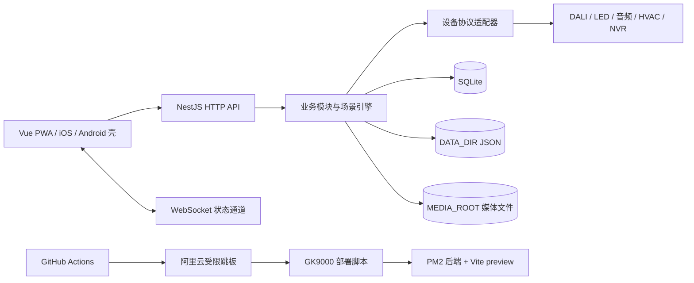
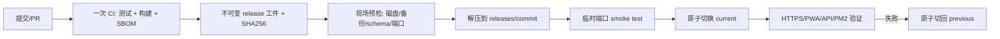
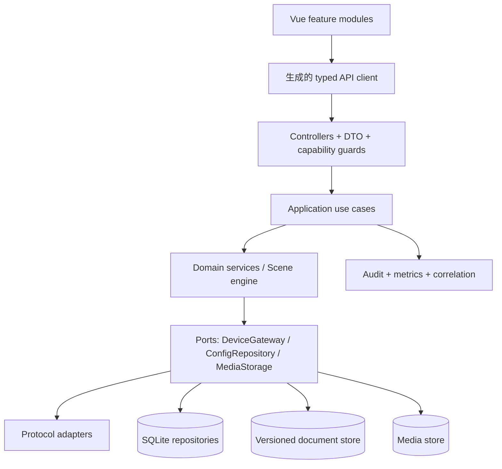

# 智慧中控工程与架构全面审计报告

> 审计日期：2026-09-16
>
> 代码基线：`main@f7dae609d586156933c14e29fd55be9c159c21b6`
>
> 审计范围：Vue PWA、NestJS 后端、SQLite 与运行时文档、设备适配器、Android/iOS 壳、GitHub Actions、GK9000 部署与运维文档
>
> 方法：静态代码审计、依赖安全审计、构建产物检查、测试与发布门禁检查、生产事故证据复核
>
> 说明：成熟度评分是基于本项目当前目标和风险的工程判断，用于排序整改，不是行业认证分数。

## 一、技术结论

项目已经具备可持续演进的基础，不需要推倒重写。当前最有价值的资产是：NestJS 模块化骨架、设备协议适配器、场景引擎、SQLite 显式迁移、多用户资源隔离、媒体恢复机制、621 个后端测试、生产备份与验证脚本，以及近期补齐的 PWA 发布恢复和数据盘隔离。

当前还不能称为“成熟产品”的主要原因并非功能不足，而是以下四类风险彼此放大：

1. **秘密与依赖供应链风险必须先处理。** 仓库源码中存在设备默认凭据，Android 签名私钥和口令由仓库文件直接引用；2026-09-16 的 `pnpm audit --prod` 结果中，后端有 1 条 critical、23 条 high、18 条 moderate、3 条 low，前端有 5 条 high、10 条 moderate。这里的数量是安全公告条数，不等同于独立漏洞包数量，但足以进入发布阻断门禁。
2. **数据持久化有三套事实来源。** SQLite、`DATA_DIR` 下 JSON、`MEDIA_ROOT` 下文件分别承载业务状态；近期丢失 AI 检测范围和运营数据，正是运行时 JSON 曾落入 Git 工作区造成的。外迁已经止血，但多个控制器仍各自同步读写文件，没有统一版本、事务、并发控制和审计。
3. **前端和发布链形成高复杂度单体。** 前端源码约 35,318 行，7 个业务文件超过 1,000 行；`AudioPage.vue` 2,177 行，`MainLayout.vue` 1,123 行。现场部署脚本 965 行，内部同时处理 Git 合并、数据抢救、构建、进程管理、PWA 兼容、回滚和验证，正确性高度依赖历史补丁之间的组合。
4. **测试覆盖分布失衡。** 后端 56 个测试文件、CI 最近一次 621 项测试全部通过，基础较强；前端已有 10 个、约 1,288 行的回归测试文件，但 `package.json` 和 CI 均未执行它们，也没有浏览器端关键旅程测试。PWA 黑屏、iOS 拍照和 Service Worker 版本切换因此仍主要依赖生产后验证。

建议继续采用**模块化单体**，先统一边界、持久化、权限和发布工件，再拆大文件。现在引入微服务会增加现场网络、部署和事务复杂度，无法解决当前主要问题。

## 二、审计证据基线

### 2.1 代码与模块规模

统计口径为 Git 已跟踪源码，排除 `node_modules`、`dist`、Android 构建中间物和第三方 park-ops vendor 文件。

| 范围 | 文件数 | 源码行数 | 关键事实 |
|---|---:|---:|---|
| 后端 `backend/src` | 348 | 40,304 | 39 个 controller、44 个 service、40 个 module、36 个 entity、26 个 migration |
| 前端 `frontend/src` | 119 | 35,318 | Vue 页面、布局、组件和服务集中在单一 PWA |
| 部署与现场脚本 | 48 | 约 7,300 | `deploy-from-ci.ps1` 单文件 965 行 |
| Android 原生源码 | 3 | 878 | WebView 壳与固定内部签名发布 |
| iOS 原生源码 | 8 | 987 | SwiftUI/WKWebView 壳与 TestFlight 链路 |
| 后端测试 | 56 个 spec | 最近一次 621 项通过 | CI 已执行 |
| 前端回归测试 | 10 个 CJS 文件 | 约 1,288 | 当前 CI 未执行 |

后端和前端合计有 35 个文件达到 500 行，7 个达到 1,000 行。最大文件包括：

| 文件 | 行数 | 判断 |
|---|---:|---|
| `frontend/src/pages/AudioPage.vue` | 2,177 | 状态、协议映射、交互与视图耦合过深 |
| `frontend/src/pages/HvacPage.vue` | 1,673 | 页面承担了多个用例和设备批控逻辑 |
| `frontend/src/pages/MediaPage.vue` | 1,666 | 上传、浏览、播放、网盘和处理状态混在一页 |
| `frontend/src/components/PlayerConsole.vue` | 1,480 | 播放控制职责过多 |
| `backend/src/modules/media/media.service.ts` | 1,248 | 媒体入库、恢复、转换、删除、流式读取和配额交织 |
| `frontend/src/layouts/MainLayout.vue` | 1,123 | 导航、预取、网络恢复、触摸行为、全屏和状态展示集中 |
| `scripts/deploy-from-ci.ps1` | 965 | 发布编排、修复、迁移、回滚和验证集中 |

### 2.2 当前架构

架构方向是合理的：现场单机、低到中等并发、强硬件耦合的系统适合模块化单体和本地数据库。问题在于模块内部边界和三个存储域尚未形成统一契约。

### 2.3 成熟度评分

| 维度 | 评分（5 分制） | 证据判断 |
|---|---:|---|
| 功能与领域覆盖 | 4.2 | 灯光、LED、投影、音频、空调、媒体、场景、视频和双端 App 已形成完整产品面 |
| 后端模块化 | 3.6 | NestJS 模块和 adapter 边界清楚，但部分 controller/service 过大且持久化下沉不足 |
| 数据可靠性 | 3.0 | SQLite 迁移与媒体恢复较强；运行时 JSON 刚完成外迁，仍缺统一版本和事务 |
| 安全与权限 | 2.2 | 有全局鉴权、角色和资源隔离；仍有仓库秘密、公开写路由、粗粒度权限和依赖告警 |
| 自动化测试 | 3.2 | 后端强；前端、PWA、移动端和真实设备旅程明显不足 |
| 发布与回滚 | 3.3 | 备份、校验、回滚意识强；现场原地构建和多发布路径使脚本过于复杂 |
| 可观测性 | 3.1 | 有结构日志、健康检查、告警、操作日志和 RUM；缺统一指标、SLO 和端到端关联 ID |
| 可维护性 | 2.7 | 大文件、重复预取清单、分散 `process.env`、历史补丁注释和文档漂移增加修改成本 |
| 文档与交接 | 3.8 | 文档数量和事故记录丰富；多份状态文档存在过期或相互矛盾内容 |
| 综合判断 | **3.2** | 可稳定运营，但需完成安全、数据、发布和前端测试四项治理后再进入成熟产品阶段 |

## 三、值得保留并继续强化的部分

### 3.1 模块化单体适合现场部署

当前 NestJS 模块、设备 adapter 和场景引擎已经把大部分协议差异隔离。现场只有一台核心主机，继续保持单进程事务和本地 IO 可以减少网络故障点。目标应是强化模块边界，而非拆成微服务。

### 3.2 后端测试已经形成重要护城河

56 个测试文件覆盖协议帧、资源隔离、媒体配额、上传恢复、删除事务和部署相关行为。最近一次 CI 为 56 suites、621 tests 全绿。协议字节级测试和媒体恢复测试应作为后续重构的安全网保留。

### 3.3 数据保护和发布验证方向正确

近期已经完成：

- `DATA_DIR=D:\smart-control-runtime\data`，AI ROI、运营指标和翻页状态离开 Git 工作区；
- `MEDIA_ROOT` 默认使用 `D:\Media`，来访照片随媒体记录进入独立媒体目录；
- SQLite 关闭 `synchronize` 并增加启动 schema gate；
- 部署前备份、运行时文档迁移、PWA 旧资源保留、健康检查和失败回滚；
- 生产 HTTPS 与安全上下文验证、87 个 PWA 静态资源验证、数据库健康验证。

这些机制应被收敛进更小、更可测试的发布器，而不是删除。

## 四、P0：立即处理的阻断项

### 4.1 仓库内秘密和签名材料必须迁出并轮换

**证据**

- `backend/src/modules/cameras/video-binding.service.ts:109-122` 包含 NVR 默认用户名和密码；首次没有运行时文件时会将其写入配置。
- `getConfig()` 和 `getNvrs()` 返回完整 `NvrDevice`，其中包含 `password`；`video-binding` controller 未使用配置写保护 guard。
- `android-app/signing/internal.p12` 被 Git 跟踪，`android-app/app/build.gradle.kts:30-34` 直接引用签名文件和口令。
- 后台和客户端仍存在已知初始密码策略。提示改密不能替代首次启动强制改密。

**风险**

- Git 历史中的秘密即使从当前文件删除，也应视为已经泄露。
- 任意取得普通操作员令牌的主体可读取 NVR 凭据或修改视频绑定配置。
- Android 签名私钥泄露会允许伪造可覆盖安装的内部 APK。

**整改**

1. 将 NVR 凭据迁到 Windows Credential Manager、DPAPI 加密存储或独立 secrets 文件；数据库/JSON 仅保存 `credentialRef`。
2. API 输出使用 `NvrView`，永不返回密码；修改密码使用单独字段并在响应中固定返回 `hasPassword`。
3. 给 `VideoBindingController` 增加 `ConfigurationWriteGuard`；只有管理员能改配置，普通操作员只读显示通道。
4. 轮换两台 NVR 的密码。提交历史中的旧密码视为不可继续使用。
5. 将 Android 签名材料存入 GitHub Actions encrypted secrets 或受控签名机。现有安装包的签名迁移需单独制定维护窗口，避免终端无法覆盖升级。
6. 首次启动生成随机临时密码或进入初始化流程；首次登录必须改密。

**验收**

- 对整个 Git 历史执行 secret scan 无有效凭据；
- 非管理员访问 NVR 配置只能看到脱敏字段，修改返回 403；
- CI 仍能签名构建，仓库不再包含私钥和口令；
- 现场 NVR 旧凭据失效。

### 4.2 依赖漏洞需要建立升级批次和阻断门禁

**2026-09-16 审计结果**

| 范围 | critical | high | moderate | low | 主要直接或传递依赖 |
|---|---:|---:|---:|---:|---|
| 后端生产依赖 | 1 | 23 | 18 | 3 | `tar`、`multer`、`@nestjs/core`、`typeorm`、`ws`、`qs`、`lodash` 等 |
| 前端生产依赖 | 0 | 5 | 10 | 0 | `axios` 及其 `form-data`，构建链中的 `nanoid`、`postcss` |

后端的 critical `tar` 经 `sqlite3 -> node-gyp` 传递进入；`multer` 当前固定为 2.0.2；前端锁定得到 `axios` 1.16.1。不能只运行自动 `audit fix`，需要按兼容批次升级并执行媒体上传、数据库驱动和 PWA 回归。

**整改顺序**

1. 删除未实际使用的依赖。前端主 HTTP 层已经使用原生 `fetch`，仅 `media.service.ts` 仍用 axios，应统一后删除 axios。
2. 升级 `multer`、`ws`、`typeorm` 与可安全覆盖的传递依赖；评估只保留 `better-sqlite3` 后是否可移除 `sqlite3`，从根上移除旧 `node-gyp/tar` 链。
3. 将 NestJS 10 升级到其安全维护版本，若公告只在新主版本修复，则建立 NestJS 11 兼容分支验证。
4. CI 增加生产依赖审计：critical/high 默认阻断；对不可利用或短期无法升级的公告使用有责任人、到期日和理由的例外清单。
5. 增加 SBOM 和依赖自动更新 PR，每周一次，避免再次累积。

### 4.3 公开 HLS 启停接口暴露了资源控制能力

`backend/src/modules/cameras/cameras.controller.ts:53-68` 的 HLS start/stop 是 `@Public()` POST。匿名调用者可以反复创建或停止 FFmpeg 转码，形成 CPU、进程和可用性风险。`hls/sessions` 也公开暴露运行态。

建议保留 HLS 分片和必要的播放清单匿名读取，将 start/stop 改为：

- 后端按引用计数或固定白名单自动管理生命周期；
- 管理接口要求操作员令牌，并增加每通道幂等锁和速率限制；
- 公共播放页面只能请求播放，不直接控制进程；
- 会话详情仅管理员可见。

### 4.4 CORS 与安全响应头需要显式收口

后端目前调用无参数 `app.enableCors()`，允许任意来源。虽然业务接口有令牌，但来源不受限会扩大令牌误用和浏览器攻击面。项目也未形成统一的 CSP、HSTS、frame policy 和 MIME sniffing 策略。

建议按生产域名、现场局域网入口和原生壳 origin 建立 allowlist；通过 `helmet` 或 nginx 设置安全响应头。摄像头、媒体和 WebSocket 端点需单独验证兼容性，避免一次性全开严格 CSP 造成生产白屏。

## 五、P1：影响可靠性和维护成本的核心问题

### 5.1 三种持久化方式需要统一存储契约

当前状态分布如下：

| 数据 | 当前位置 | 特性 | 建议归属 |
|---|---|---|---|
| 用户、设备、场景、媒体元数据 | SQLite | 有事务、迁移和实体 | 保留 |
| 视频绑定、AI ROI、运营指标 | `DATA_DIR/*.json` | 原子覆盖 + 单份 `.bak` | 迁入版本化配置仓库 |
| 运营大屏翻页状态 | `DATA_DIR/*.json` | 高频同步写、GET 可消费状态 | 作为短期运行态，不与长期配置混合 |
| 媒体与来访照片 | `MEDIA_ROOT/<id>/...` | 大文件，数据库记录路径 | 保留，强化校验和备份 |

三个 JSON 写入点分别实现了自己的同步 IO、备份和恢复。当前单实例下不一定立即出错，但没有乐观锁，两个并发编辑会“最后写入者覆盖”；也没有统一的 schema version、审计和回滚历史。

建议实现一个 `RuntimeDocumentStore<T>`：

- 统一 `schemaVersion`、`revision`、`updatedAt`、`updatedBy`；
- `compare-and-set` 保存，客户端提交旧 revision 时返回 409；
- 统一临时文件、fsync、原子 rename、校验和、备份轮转和损坏恢复；
- 配置类文档逐步迁入 SQLite `configuration_document` 表，翻页这类短期状态可留在内存并定期快照；
- 所有更新写操作日志和差异，支持后台查看与回滚；
- 写入服务层，不在 controller 中直接操作文件。

### 5.2 数据库迁移与启动时改表存在双重事实来源

项目已增加 `assertSchemaReady()`，明确要求先备份再运行 migration；但 `AdminAuthService`、`ClientAuthService`、`SystemBrandingService` 等仍在 `onModuleInit` 中执行 `ALTER TABLE` 并吞掉异常。

这会造成两种问题：

- migration 表显示的历史与真实 schema 可能不同；
- 权限错误、磁盘错误和 SQL 错误会被当成“字段已存在”吞掉，延迟暴露真实故障。

建议新版本停止新增任何启动自愈 DDL。先增加一次 schema 核对和迁移，把历史自愈覆盖的列纳入显式 migration；验证生产数据库后删除服务内 DDL。启动只读检查可以保留，并应输出缺少的 migration 和列名。

### 5.3 前端测试存在，但没有进入任何质量门禁

`frontend/tests` 已有 10 个 CJS 测试，覆盖身份边界、媒体浏览、播放实时性、PWA 隐私和运营大屏等，但前端 `package.json` 没有 `test` script，CI 只执行 `vue-tsc` 和 `vite build`。

建议分三层补齐：

1. **立即接入现有测试：** `node --test tests/*.test.cjs`，在 CI 和 GK9000 validate 中执行。
2. **组件与服务层：** 使用 Vitest 覆盖 route manifest、HTTP 身份边界、PWA recovery、媒体上传状态机和大页面拆出的 composable。
3. **浏览器关键旅程：** Playwright 验证登录、灯光页、LED/投影页、媒体上传、照片上墙、Service Worker 旧版本升级和 chunk 404 恢复。iOS 相机仍需真机 smoke test，因为桌面 WebKit 不能完全模拟 iOS PWA 权限和进程回收。

发布门禁至少要有两个浏览器旅程：

- 冷启动并逐页打开所有主菜单，任何页面不得黑屏；
- 保留旧 Service Worker 后部署新版本，再逐页打开，旧客户端必须完成升级或自愈。

### 5.4 大型 Vue 文件应按业务用例拆分

拆分目标不是追求小文件，而是让每个变更只触及一个业务边界。

| 当前文件 | 建议拆分 |
|---|---|
| `AudioPage.vue` | `useAudioMatrix`、`useAudioScenes`、`useBgmPlayback`，矩阵/输入/输出/场景子组件 |
| `HvacPage.vue` | 区域列表、批量控制、单机控制、网关诊断 composable 和组件 |
| `MediaPage.vue` | 媒体库、上传队列、第三方导入、处理状态、播放发布五个 feature |
| `PlayerConsole.vue` | 播放队列、文档控制、屏幕发布、状态显示 |
| `MainLayout.vue` | `routeManifest`、PWA 网络恢复、预取调度、移动导航、全屏控制 |

`App.vue` 和 `MainLayout.vue` 目前都有页面预取清单，`MainLayout` 又维护 hover 预取清单和 API 预取清单。应建立单一 `routeManifest`，每个路由声明组件 loader、预取 API、权限和导航元数据，路由、菜单和预取都从它生成，避免以后新增页面漏掉某份清单再次黑屏。

### 5.5 后端大服务需要拆成应用用例与基础设施服务

`MediaService` 同时处理入库、临时文件、配额、孤儿扫描、恢复、转码、文档转换、删除事务和流读取。建议保持一个 `MediaModule`，内部拆为：

- `MediaCatalogService`：元数据与查询；
- `MediaIngestService`：上传、导入、配额预留；
- `MediaProcessingService`：转码和文档派生物；
- `MediaStorage`：路径、原子移动、删除与边界校验；
- `MediaRecoveryService`：启动恢复和孤儿处理；
- `MediaDeliveryService`：Range/下载/缩略图读取。

对 `CamerasService`、`TestCenterService` 和 `HvacController` 采用同样原则：controller 只负责 HTTP DTO 和权限，应用服务表达用例，adapter 负责协议。

### 5.6 DTO 和 API 合同不完整

全局 `ValidationPipe` 已正确开启白名单和拒绝未知字段，但 136 个 `@Body` 参数中仍有大量 inline type、interface、`Partial<>`、`Omit<>` 或 `unknown`。TypeScript 接口在运行时不存在，无法触发 `class-validator`。

重点包括视频绑定、播放控制、投影控制、认证、百度网盘和部分媒体接口。建议：

- 所有外部写接口使用 class DTO；
- 数值、枚举、数组长度、字符串长度和嵌套对象明确验证；
- OpenAPI 作为 HTTP 合同，生成前端类型和客户端；
- 统一响应包装，控制器不再手写不同形状的 `{success,data}`；
- 契约测试验证公开端点、角色矩阵和错误码。

### 5.7 权限应从“能否写”升级为明确能力矩阵

当前全局 guard 能识别 admin/operator/viewer，viewer 非 GET 被阻断；配置模块开始使用 `ConfigurationWriteGuard`，方向正确。但尚未覆盖视频绑定等配置控制器，设备控制、配置管理、系统运维和媒体管理的能力边界仍分散在 controller 中。

建议定义能力：

- `device.control`
- `configuration.read`
- `configuration.write`
- `media.manage.own`
- `media.manage.all`
- `system.operate`
- `system.restore`
- `credentials.manage`

通过装饰器和统一 guard 映射角色。备份还原、进程重启、凭据管理必须使用最高权限，并要求审计理由；公开端点建立显式清单和测试，禁止随手加 `@Public()`。

### 5.8 部署应转为“CI 构建一次，现场只验证和切换”

当前 GK9000 在生产工作区执行 Git 获取、依赖安装和构建，然后由脚本原地更新 `dist`。部署脚本还保留与本机 watcher 竞争的处理分支，说明系统仍存在两个可能写生产目录的发布者。前端由 `vite preview` 提供静态文件，也不是面向长期生产的静态服务方案。

目标流程：

具体建议：

- CI 只构建一次，deploy 复用相同 artifact，避免“CI 通过的是 A，现场重新构建得到 B”；
- 前后端进入按 commit 命名的 release 目录，保留最近 2-3 个；
- 使用 nginx/Caddy 或极简静态文件服务替代生产 `vite preview`；
- 停用生产 watcher 和旧 `update.ps1` 发布入口，保留一个受限部署命令；
- 低风险静态内容可自动发布，高风险依赖、migration、部署脚本和权限变更进入 GitHub Environment 审批或维护窗口；
- 部署脚本按 preflight、backup、stage、migrate、switch、verify、rollback 拆成可单测模块；
- 数据目录和媒体目录永不成为 release 的子目录。

### 5.9 分支和制品治理需要收口

审计时本地存在长期分叉工作树和历史备份分支；Android workflow 构建后直接向 `main` 提交 APK 和 manifest。这会绕过正常评审，并触发第二轮主分支部署。

建议：

- `main` 开启保护：必须 PR、CI、至少一名 reviewer；自动化机器人只可提交到发布分支或创建 PR；
- APK/IPA 使用 GitHub Release、Actions artifact 或对象存储，不把二进制提交回源码主分支；
- 发布 manifest 由部署时读取 artifact 元数据生成；
- 定期清理已合并 worktree 和过期分支，明确 `feat/ios-app` 等长期分叉的处置决定；
- 仓库中已跟踪的 WAL、SHM 和日志从 index 移除。`.gitignore` 不能自动取消已跟踪状态。

## 六、P2：产品成熟度建设

### 6.1 集中配置并校验环境变量

后端源码中约有 179 处 `process.env` 访问，分布在 42 个文件。建议所有环境变量进入 typed configuration：启动时一次性校验类型、范围、路径和生产必填项；业务服务只依赖 `ConfigService` 或领域配置对象。这样可以消除 `.env`、PM2 和默认值之间的优先级歧义。

### 6.2 建立 SLO 和端到端可观测性

项目已有健康检查、Winston、操作日志、告警通知和前端 RUM，应统一为：

- 请求 correlation ID，从 PWA 到 controller、adapter 和设备 IO；
- API 延迟 P50/P95/P99、错误率、WebSocket 重连率、FFmpeg 会话数、事件循环延迟；
- 设备命令队列长度、超时率、重试率；
- SQLite 写耗时、WAL 大小、磁盘剩余、媒体处理积压；
- PWA 版本、Service Worker 版本、chunk 加载失败率和恢复成功率；
- SLO 示例：核心控制 API 月可用性 99.9%，现场 P95 控制确认小于 1 秒，PWA 主菜单黑屏率为 0。

告警需要区分“设备断电的预期离线”和“系统故障”，避免告警疲劳。

### 6.3 文档从历史记录升级为可执行知识库

文档很丰富，但 `MEMORY.md`、CI 文档、部署脚本注释和实际 workflow 存在时间线漂移。建议建立以下权威入口：

- `docs/architecture/README.md`：当前架构与模块所有者；
- `docs/adr/`：权限、存储、PWA 发布、部署方式等架构决策；
- `docs/runbooks/`：备份恢复、证书、摄像头、媒体盘、数据库损坏；
- `docs/releases/`：每次生产版本、迁移、回滚方法；
- 自动检查文档中的文件路径、命令和关键配置名；
- 源码中的长篇事故注释移到 ADR/INCIDENTS，代码只保留为什么存在该约束和文档链接。

### 6.4 建立硬件和 PWA 兼容矩阵

成熟产品需要明确支持范围：

- iPhone/iOS 版本、Safari/PWA/原生壳；
- Android WebView 版本；
- GK9000 Windows 与 Node/pnpm/PM2 版本；
- LED、DALI、音频、HVAC、NVR 固件；
- HTTPS 入口、局域网入口和离线运行模式。

每个生产版本至少执行一组自动化 smoke 和一组真机/真实设备抽样，结果写入 release 记录。

## 七、目标架构

### 目标边界

1. **Controller**：只负责协议转换、DTO、权限和状态码。
2. **Application service**：一个公开方法对应一个用户用例，负责事务边界。
3. **Domain service**：场景编排、配额、状态机和规则，不依赖 HTTP 或文件路径。
4. **Port/adapter**：设备协议、SQLite、运行时文档和媒体文件通过接口接入。
5. **Frontend feature**：每个业务域拥有页面、组件、store、service 和测试；全局壳只负责导航和会话。

## 八、分阶段路线图

### 阶段 0：风险封口（1-2 周）

| 编号 | 工作 | 产出 | 验收 |
|---|---|---|---|
| S0-1 | 秘密扫描、NVR 凭据迁移与轮换 | 仓库无有效秘密，API 脱敏 | 历史扫描通过，旧凭据失效 |
| S0-2 | Android 签名材料迁出 | CI secrets/签名机方案 | 私钥不在 Git，安装升级方案验证 |
| S0-3 | 依赖安全升级第一批 | 无 critical，high 有限期例外 | audit 门禁通过 |
| S0-4 | 收紧 HLS 和视频绑定权限 | 能力矩阵首批落地 | 匿名写全 403，角色契约测试通过 |
| S0-5 | 前端现有 10 个测试接入 CI | `pnpm test` | CI 确实执行并报告测试数 |
| S0-6 | WAL/SHM/日志退出 Git index | 仓库状态干净 | 生产运行文件不再阻塞部署 |

### 阶段 1：可靠性收敛（2-4 周）

| 编号 | 工作 | 产出 | 验收 |
|---|---|---|---|
| S1-1 | `RuntimeDocumentStore` | JSON 统一 revision/校验/审计/备份 | 并发更新返回 409，损坏可恢复 |
| S1-2 | 移除启动时 DDL | 单一 migration 真相 | 空库升级、生产备份副本升级均通过 |
| S1-3 | DTO 与 OpenAPI 第一批 | 视频、播放、系统运维合同 | 非法输入 400，前后端类型一致 |
| S1-4 | 两条 PWA 浏览器旅程 | 冷启动与跨版本升级测试 | 主菜单无黑屏，旧 SW 可恢复 |
| S1-5 | 统一 route manifest | 路由、菜单、预取单一来源 | 新增页面只改一份定义 |

### 阶段 2：可维护性与发布重构（4-8 周）

| 编号 | 工作 | 产出 | 验收 |
|---|---|---|---|
| S2-1 | 拆分 Audio/HVAC/Media/MainLayout | feature + composable | 页面行为不变，核心逻辑有测试 |
| S2-2 | 拆分 MediaService | 六个内部服务 | 上传、恢复、转换、删除测试全绿 |
| S2-3 | 不可变 release 部署 | 构建一次、原子切换 | 失败 5 分钟内自动回滚，无现场构建 |
| S2-4 | 生产静态服务替换 Vite preview | nginx/Caddy/静态 server | PWA 缓存头和 404 行为验收通过 |
| S2-5 | 停用 watcher/旧发布入口 | 单一发布者 | 生产只有受限 deploy 命令能写 current |

### 阶段 3：持续产品化

- SLO、仪表盘、告警分级和容量趋势；
- 设备/固件/浏览器兼容矩阵；
- 备份恢复演练每季度一次；
- 依赖自动更新和 SBOM；
- ADR、发布记录和 runbook 持续维护；
- 真实 iPhone 拍照上墙、PWA 升级、三路大屏和关键设备抽样验收。

## 九、优先级总表

| 优先级 | 问题 | 业务影响 | 建议投入 |
|---|---|---|---|
| P0 | 仓库秘密、NVR 凭据、Android 签名材料 | 凭据泄露、伪造安装包 | 立即立项，分维护窗口轮换 |
| P0 | critical/high 依赖公告 | 供应链和输入处理风险 | 2-5 人日首批，持续治理 |
| P0 | 匿名 HLS 启停 | 可用性和资源耗尽 | 0.5-1 人日 |
| P1 | 运行时 JSON 分散 | 配置覆盖、并发丢失、不可审计 | 3-6 人日 |
| P1 | 启动自愈 DDL 与 migration 并存 | schema 漂移、故障被吞 | 2-3 人日 |
| P1 | 前端测试未进 CI | 黑屏、PWA 回归晚发现 | 1 人日接入，3-5 人日补 E2E |
| P1 | 千行级前端与 MediaService | 修改风险和定位成本高 | 10-20 人日分批 |
| P1 | 现场原地构建和部署脚本膨胀 | 发布结果不确定、回滚复杂 | 5-10 人日 |
| P1 | DTO/权限合同不完整 | 非法输入和越权风险 | 5-10 人日分模块 |
| P2 | 环境变量分散 | 环境漂移、默认值误用 | 2-4 人日 |
| P2 | 指标和 SLO 不完整 | 只能靠用户反馈发现问题 | 3-6 人日 |
| P2 | 文档漂移 | 交接误判和误操作 | 2-3 人日首轮治理 |

## 十、工程门禁建议

### 合并门禁

- 后端 lint、build、621+ tests；
- 前端 typecheck、build、现有 CJS tests、关键 Vitest；
- 依赖 audit 与 secret scan；
- migration 只读检查和备份副本升级测试；
- API 契约和角色矩阵测试；
- 关键路径变更需要对应 ADR 或 runbook 更新。

### 生产发布门禁

- release artifact commit、hash、SBOM 可追溯；
- 数据库、`DATA_DIR`、`MEDIA_ROOT` 备份完成且可读；
- 磁盘余量和 release hold 通过；
- 临时端口 smoke 通过后原子切换；
- HTTPS、安全上下文、API health、数据库、WebSocket、PWA 资源、Service Worker、三路播放器心跳全部通过；
- 高风险变更设置人工批准或维护窗口；
- 自动回滚验证后仍失败才需要现场介入。

### 完成定义

一项功能只有同时满足以下条件才算完成：

1. 有明确权限和输入合同；
2. 数据写入有事务、版本或幂等保证；
3. 有能捕获真实回归的测试；
4. 有日志、指标或可诊断错误；
5. 有可逆部署和回滚方法；
6. 文档描述当前事实；
7. 在目标终端或真实设备上完成适当级别验收。

## 十一、限制与待确认事项

本次审计能够确认代码、依赖、CI、构建产物和现有生产验证证据，但没有在审计阶段执行以下破坏性或硬件相关操作：

- 没有轮换现场 NVR 或 Android 签名密钥；
- 没有修改生产数据库 schema；
- 没有对真实 DALI、LED、音频、HVAC 设备执行控制压力测试；
- 没有用真实 iPhone 完成整套 PWA 安装、系统相机、后台恢复和内存回收测试；
- 依赖公告是否可被本项目具体调用路径利用，需要在升级批次中逐项确认，但 critical/high 仍应先按风险门禁处理。

后续需要由产品负责人确认两个治理决策：

1. 操作员是否允许修改 AI ROI、视频绑定和其他现场配置；建议默认只有管理员允许，操作员只负责日常设备控制。
2. Android 现有安装终端是否接受一次维护窗口，用于迁移离库签名方案；这决定签名密钥是先安全托管还是同时轮换。

## 十二、最终建议

项目下一阶段不应继续以“出现一个现场问题就向大文件和部署脚本追加一个补丁”为主。应先完成阶段 0 和阶段 1，把秘密、依赖、权限、数据版本和前端测试变成统一门禁；随后拆分前端页面和媒体服务，并将部署改为不可变工件和原子切换。

完成前两阶段后，项目可以从“功能完整、依靠熟悉历史的人维护”提升为“边界清楚、变更可验证、数据可恢复、发布可回滚”的成熟产品。后续新增设备和功能会更快，因为开发者不再需要同时理解页面、存储、权限、发布和历史事故补丁才能安全修改一个模块。
